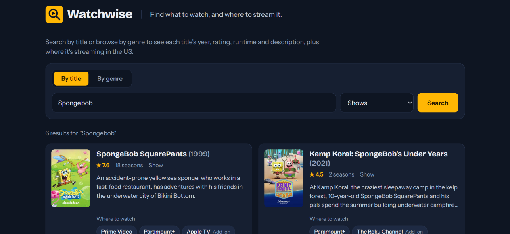

# Watchwise

Find what to watch, and where to stream it. Search any movie or show by title, or browse by genre, and see each title's year, rating, runtime, description and the US streaming services that carry it.

**Live demo:** [your-site.vercel.app](https://your-site.vercel.app)



## Features
- Search movies and shows by title
- Browse by genre, sorted by popularity, with Load more pagination
- Streaming links for each result (subscription and free options first, rent/buy last)
- Responsive layout, keyboard-accessible tabs, loading and error states

## Tech stack
- HTML, CSS and vanilla JavaScript (no framework, no build step)
- Vercel serverless function (Node.js) as an API proxy
- [Streaming Availability API](https://rapidapi.com/movie-of-the-night-movie-of-the-night-default/api/streaming-availability/details) via RapidAPI
- Deployed on Vercel from GitHub

## How it works
The browser never talks to the streaming API directly. `script.js` calls `/api/movies`, a serverless function that adds the RapidAPI key from an environment variable and forwards the request. This keeps the key out of front-end code and out of the repo, and lets the function return clear error responses for rate limits and auth problems.

Other details worth noting:
- Results are HTML-escaped and links are validated before rendering
- The genre list is loaded from the API; results are de-duplicated across pages and ordered by popularity
- Handles rate limiting (429), rejected keys, empty results and network failures with friendly messages

## Project structure
```
index.html        page structure
style.css         all styling
script.js         search, rendering and pagination
api/movies.js     serverless API proxy (must stay in api/)
logo.svg          logo and favicon
```

## Run locally
The app needs the serverless function, so opening `index.html` directly won't fetch data. Use the Vercel CLI instead:

```
npm i -g vercel
echo "RAPIDAPI_KEY=your_key_here" > .env
vercel dev
```

## Deploy
1. Push the repo to GitHub.
2. Import it in Vercel with the framework preset set to Other and no build command.
3. Add `RAPIDAPI_KEY` under Project Settings > Environment Variables, then redeploy.

## Attribution
Streaming data from the Streaming Availability API. See their [terms](https://rapidapi.com/movie-of-the-night-movie-of-the-night-default/api/streaming-availability/details) for attribution requirements.
